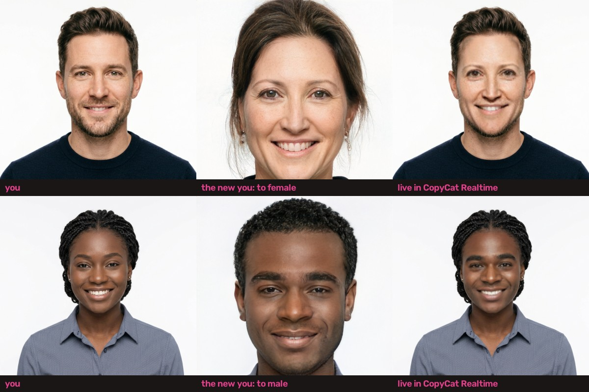
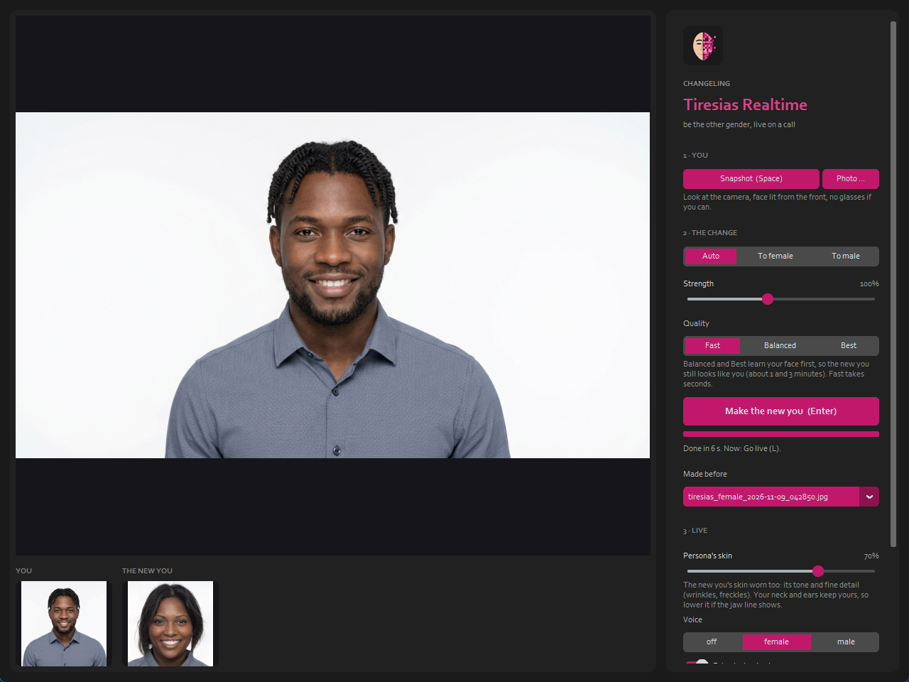
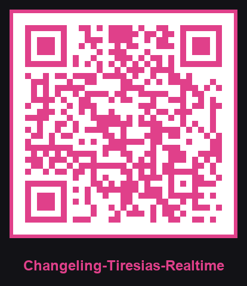

  

# Changeling Tiresias Realtime

**Website:** https://cursedprograms.github.io/Changeling-Tiresias-Realtime/

Be the other gender, live on a video call. One snapshot of you, swapped to the other gender by Changeling Tiresias, then worn live by Changeling CopyCat Realtime: your own expressions, the other you's face, out to the call through OBS Virtual Camera. The voice can follow (female or male, or Changeling Echo's trained voices).

*Part of the Changeling family, all together in [Changeling Studio](https://github.com/CursedPrograms/Changeling-Studio):
[CopyCat](https://github.com/CursedPrograms/Changeling-CopyCat) ·
[CopyCat Realtime](https://github.com/CursedPrograms/Changeling-CopyCat-Realtime) ·
[Tiresias](https://github.com/CursedPrograms/Changeling-Tiresias) (gender) ·
[Chronos](https://github.com/CursedPrograms/Changeling-Chronos) (age) ·
[Natio](https://github.com/CursedPrograms/Changeling-Natio) (where in the world) ·
[Cosmetics](https://github.com/CursedPrograms/Changeling-Cosmetics) (makeup, hair, beards) ·
[Echo](https://github.com/CursedPrograms/Changeling-Echo) (voices) ·
realtime: [Tiresias](https://github.com/CursedPrograms/Changeling-Tiresias-Realtime) ·
[Chronos](https://github.com/CursedPrograms/Changeling-Chronos-Realtime) ·
[Natio](https://github.com/CursedPrograms/Changeling-Natio-Realtime).*

## Why a snapshot, not every frame

[Changeling Tiresias](https://github.com/CursedPrograms/Changeling-Tiresias) edits a face with StyleGAN2: it finds the
face's place in StyleGAN's space (e4e), learns the face for a minute so the result still looks like you (pivotal
tuning), and moves it. That's far too slow for 30 frames a second. So it's done once, on one snapshot of you, and
[Changeling CopyCat Realtime](https://github.com/CursedPrograms/Changeling-CopyCat-Realtime) wears the result live: a
face swap that follows your expressions, head turns and talking, at camera speed. The new you looks steady, because
it's the same face in every frame.

## Use it

1. Python 3.9 - 3.12, an NVIDIA GPU (4 GB is enough), a webcam. For calls:
   [OBS](https://obsproject.com/) (its Virtual Camera) and, for the voice,
   [VB-Audio Virtual Cable](https://vb-audio.com/Cable/).
2. Start `run.bat` (or `run.ps1`, `run.sh`). It needs Changeling Tiresias and Changeling CopyCat Realtime next to
   this folder, as in [Changeling Studio](https://github.com/CursedPrograms/Changeling-Studio); any that are missing
   are cloned there, and Changeling Tiresias is set up the first time (its environment and models). No environment of
   its own: it runs in Changeling Tiresias's.
3. **1 · You:** **Snapshot** (Space: a 3-second countdown) or a **Photo**. Face the camera, lit from the front.
4. **2 · The change:** **To female / To male** (or **Auto**: the opposite of the face it sees) and the strength; **Quality** (Fast takes seconds; Balanced about a minute and keeps you
   recognisable). **Make the new you** (Enter), with a completion bar. Everything you make is kept in `made/`
   (only on this PC) and listed under **Made before**.
5. **3 · Live:** **Persona's skin** (70 to start: the new you's skin tone and fine detail, like Chronos's
   wrinkles, which the face swap alone would leave as yours), the **voice** (off, female, male; **Echo** for Changeling Echo's trained voices) and **Go live**
   (L): CopyCat Realtime opens wearing the new you. In the call, pick **OBS Virtual Camera** as the camera (and
   **CABLE Output** as the microphone). Close CopyCat Realtime to come back and make another.

`run.bat --camera 1` (another webcam), `run.bat --source me.jpg` (a photo or a video instead of the webcam, for
trying it out without one).

## Its limits

- The live face is a 128-pixel swap: it carries the new you's features and, with **Persona's skin**, its tone
  and wrinkles, but softer than the photo Changeling Tiresias made. Your neck and ears keep your own skin tone.
- The swap carries the face, not the hair, neck or body: the new you's hair (Changeling Tiresias may change it) stays
  behind. A hood, a hat or a wig helps.
- One look per snapshot: to look different, make another.
- Use it on yourself, or on people who agreed; never to pass as someone real.

## Licenses

MIT. Changeling Tiresias is MIT (the StyleGAN2 FFHQ weights are NVIDIA's, non-commercial); Changeling CopyCat Realtime
uses InsightFace's inswapper (non-commercial research). So this is for personal and research use.

---

 

© Cursed Entertainment 2026

 

 

  

